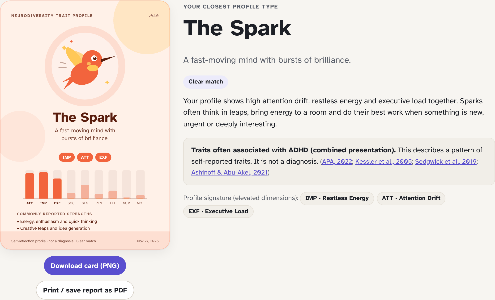
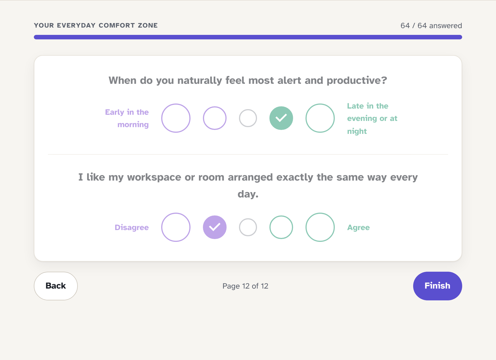
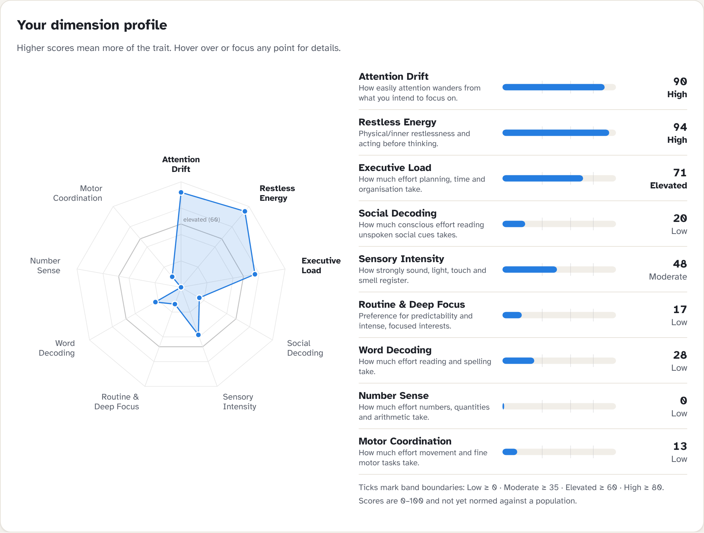
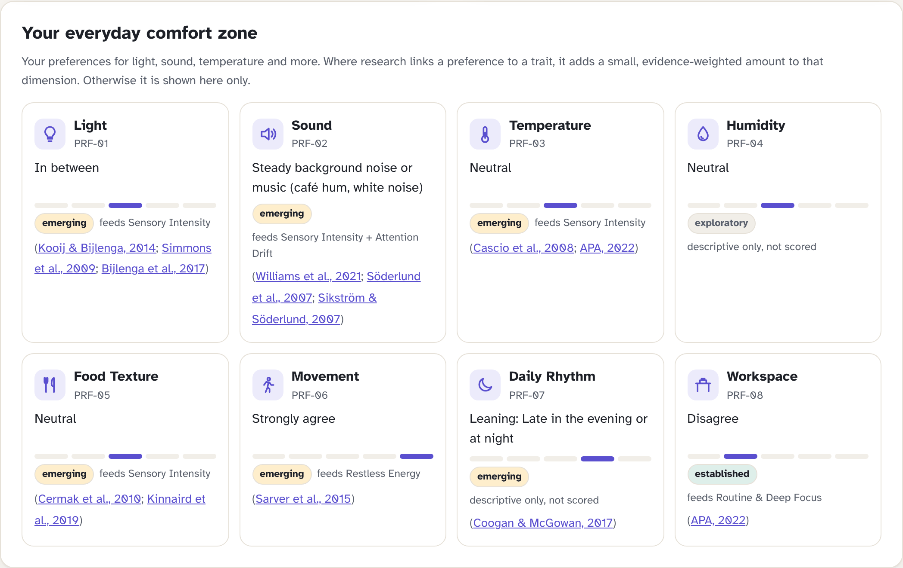
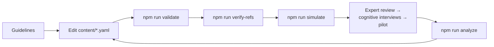

# Neurodiversity Trait Profile

An evidence-cited, transparent **neurodiversity trait test** with an MBTI-style flow. It measures 9 trait dimensions and the respondent's everyday comfort zone (light, sound, temperature, humidity…), then produces a **visual report** and a **cartoon type card**.

> **Not a diagnostic tool.** This is a self-reflection instrument in early development (v0.1.0, *draft*). It has not been piloted or normed yet. Only a qualified professional can diagnose ADHD, autism, dyslexia, dyscalculia or dyspraxia.

<p align="center">
  
</p>

## The three traceable documents

The frontend holds **no test content and no scoring logic of its own**. It reads the content files at build time and runs them through a pure scoring engine. To iterate on the test, you edit these, not the UI:

| # | Document | Human-readable | Machine-readable (read by the app) |
|---|---|---|---|
| 1 | **Question Bank Design Guidelines** | [docs/01-question-bank-design-guidelines.md](docs/01-question-bank-design-guidelines.md) | enforced by `npm run validate` (rule IDs `G-x.y`) |
| 2 | **Test Set + Type Set** | [docs/02-test-set-and-type-set.md](docs/02-test-set-and-type-set.md) | [`content/test-set.yaml`](content/test-set.yaml), [`content/type-set.yaml`](content/type-set.yaml) |
| 3 | **Scoring Mechanism** | [docs/03-scoring-mechanism.md](docs/03-scoring-mechanism.md) | [`content/scoring.yaml`](content/scoring.yaml) → [`src/engine/`](src/engine) |
| + | **Evidence base** | [docs/generated/evidence-matrix.md](docs/generated/evidence-matrix.md), [references](docs/generated/references.md) | [`content/references.yaml`](content/references.yaml) |

Each file carries its own version and changelog. Every report and research export is stamped with the versions that produced it.

## What's in v0.1.0

- **9 dimensions × 6 items** (54 trait items): Attention Drift, Restless Energy, Executive Load, Social Decoding, Sensory Intensity, Routine & Deep Focus, Word Decoding, Number Sense, Motor Coordination.
- **8 everyday-preference items** ("comfort zone"): light, sound, temperature, humidity, food texture, movement, daily rhythm, workspace. They feed a dimension only where research supports it; otherwise they're descriptive.
- **Evidence on every item.** Each item has a level (*established* 45, *emerging* 15, *exploratory* 2), a one-line basis (e.g. a DSM-5-TR criterion) and citations. The **evidence level sets the scoring weight** (1 / 0.5 / 0), so unsupported items (e.g. humidity) are collected but never scored.
- **72 references, 67 DOIs verified against Crossref** (`npm run verify-refs`, [report](reports/reference-verification.md)).
- **10 types**, each a prototype profile with a hand-drawn mascot: The Spark 🐦, The Daydreamer 🦦, The Deep Diver 🐙, The Kaleidoscope 🦝, The Storyteller 🦊, The Wordsmith 🦜, The Improviser 🐧, The Tuner 🐰, The Navigator 🐢, The Mosaic 🦎 (fallback).
- **Probabilistic classification** (weighted prototype distance + softmax), with blends, a fallback type and confidence labels, rather than hard MBTI dichotomies.
- **Optional Go/No-Go reaction task** (commission errors, RT variability) blended in at a capped weight.
- **Response-quality checks:** attention checks, consistency pairs, straight-lining, speed.
- **Full traceability in every report:** item → keyed value → weight → dimension → distance → type.
- Accessible: Atkinson Hyperlegible typeface, text size and spacing controls, dark mode, keyboard answering (1-5), mobile layout. Answers stay in the browser.

| Question flow | Dimension profile | Comfort zone |
|---|---|---|
|  |  |  |

## Quick start

```bash
npm install
```

```bash
npm run dev
```

Then open the printed URL. Pages: `#/` (start), `#/test`, `#/results`, `#/method` (all content, evidence and parameters rendered from the YAML files), `#/lab` (scoring playground and demo reports).

## The iteration loop



| Command | What it does |
|---|---|
| `npm run validate` | Checks the content against the guideline rules: coverage, keying balance, wording, evidence levels, citation integrity, cross-file versions, type and scoring rules. Blocks the build on errors. |
| `npm run verify-refs` | Fetches every DOI from Crossref and compares title, year, journal, first author, volume and pages → `reports/reference-verification.md`. Behind an HTTPS proxy, run it with `NODE_USE_ENV_PROXY=1`. |
| `npm run simulate` | Monte-Carlo check: can each type be recovered from synthetic respondents (confusion matrix)? Do the validity rules catch random, straight-lining and speeding responders? → `reports/simulation-report.md` |
| `npm run analyze -- <folder>` | Item analysis on pilot research exports: Cronbach's α, alpha-if-deleted, corrected item-total r, floor/ceiling, dimension inter-correlations, type × self-reported diagnosis → `reports/item-analysis.md` |
| `npm run docs` | Regenerates `docs/generated/` (evidence matrix and bibliography) from the YAML. CI fails if it's stale. |
| `npm test` | Unit tests for the scoring engine. |
| `npm run build` | validate → type-check → production build (`dist/`). |

Current results (v0.1.0): 0 validator errors and 0 warnings, 67/67 DOIs verified, 96 % simulated type recovery, 17/17 tests passing.

## Project layout

```
content/            ← the test (YAML, versioned): test-set, type-set, scoring, references
docs/               ← the three documents + generated evidence matrix and bibliography
src/engine/         ← pure TypeScript scoring engine (shared by the app and scripts)
src/app/            ← React frontend (pages, charts, mascots, type card)
scripts/            ← validate, verify-refs, simulate, analyze, build-docs
reports/            ← generated verification and simulation reports
research/responses/ ← put pilot exports here (git-ignored; never commit)
```

## Deployment

`.github/workflows/deploy.yml` builds and publishes to **GitHub Pages** on every push to `main` when the repository is public. Private repositories need a paid GitHub plan for Pages. Enable it under *Settings → Pages → Source: GitHub Actions*. `.github/workflows/ci.yml` runs validate, tests, simulation, the docs-freshness check and the build on every push and PR.

## Roadmap to a trustworthy v1

See [guidelines §9](docs/01-question-bank-design-guidelines.md#9-validation-roadmap):

1. Expert content review (I-CVI ≥ .78)
2. Cognitive interviews
3. Pilot, n ≥ 300 (α/ω ≥ .70, factor structure)
4. Convergent validity with ASRS, AQ-10, ARHQ, ADC, SPQ
5. Known-groups / ROC and test-retest
6. Data-driven types (latent profile analysis) and norms

Ethics approval is required before collecting participant data.
