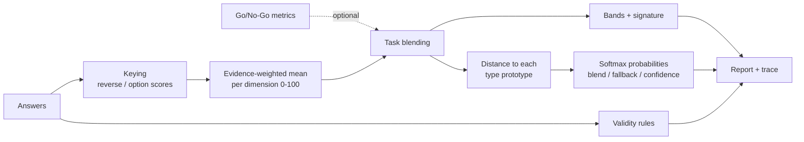

# Scoring Mechanism

| | |
|---|---|
| **Document** | 03: Scoring Mechanism |
| **Source of truth** | [`content/scoring.yaml`](../content/scoring.yaml) (v0.1.0). Every number below is a parameter in that file. |
| **Implementation** | [`src/engine/`](../src/engine): `score.ts`, `classify.ts`, `validity.ts` (unit tests in `engine.test.ts`) |
| **Checks** | `npm test`, `npm run simulate` → [reports/simulation-report.md](../reports/simulation-report.md) |

The scoring engine is a pure function: **answers + content files → report**. The UI holds no scoring logic, so the same engine runs in the browser, in the tests and in the research scripts. Every report keeps a full trace (item → keyed value → weight → dimension → distance → type), which the "How your result was calculated" section of the results page shows.



---

## 1. Keying

For a response scale with values `min..max` (0..4):

| Format | Keyed value for dimension *d* |
|---|---|
| likert / bipolar, `keyed: forward` | `k = x` |
| likert / bipolar, `keyed: reverse` | `k = (max + min) − x` |
| choice | `k = options[x].scores[d]` |

## 2. Item weights from evidence

`w_i = item.weight` if set, otherwise `evidence_weights[item.evidence.level]`:

| Level | Weight | Rationale |
|---|---:|---|
| established | 1.0 | diagnostic criterion, validated instrument or meta-analysis ([guidelines §7](01-question-bank-design-guidelines.md#7-evidence-standard)) |
| emerging | 0.5 | supported but weaker, mixed or indirect evidence |
| exploratory | 0.0 | no evidence: collected and shown, never scored |

These are a principled prior. Pilot data replaces them with empirical weights such as factor loadings (roadmap phase 3).

## 3. Dimension score

Over the scored items of dimension *d* (weight > 0) that were answered:

```
Q_d = 100 × ( Σ w_i·k_i / Σ w_i − min ) / ( max − min )
```

If fewer than `min_answered_ratio` (75 %) of the scored items are answered, the dimension is marked *insufficient* and left out of classification.

## 4. Behavioural task blending (optional)

Each task metric *m* is mapped linearly to 0-100 and clamped: `T_m = 100 × (m − from₀) / (from₁ − from₀)`. Then

```
S_d = (1 − Σ_m ω_m) × Q_d + Σ_m ω_m × T_m
```

| Metric | Dimension | ω | `from` (→ 0, → 100) | Basis |
|---|---|---:|---|---|
| commission_rate | IMP | 0.20 | 0.05 → 0.45 | response inhibition [@wright2014] |
| rt_cv | ATT | 0.15 | 0.12 → 0.40 | RT variability [@kofler2013] |
| omission_rate | ATT | 0.10 | 0.00 → 0.20 | attention lapses |

Safeguards: the total task weight per dimension must be < 0.5 (rule S-2), so the questionnaire always dominates. Metrics are ignored if fewer than 30 valid go-trials were recorded. The `from` ranges are **placeholders** until norms exist. If the task is skipped, `S_d = Q_d`.

## 5. Bands and signature

| Band | Score |
|---|---|
| Low | 0-34 |
| Moderate | 35-59 |
| Elevated | 60-79 |
| High | 80-100 |

The **profile signature** is the list of dimensions ≥ `elevated_threshold` (60), sorted by score. It appears as badges on the type card. Scores are **un-normed** in v0 (`norms.status: not_collected`). Once norms exist, `percentile = Φ((S − μ)/σ)` is reported next to each score.

## 6. Type classification

Each prototype type *t* gives a target `τ_td` and weight `v_td` for every dimension: core dimensions use `core_weight` (1.0), others use `peripheral_weight` (0.35). Levels: high = 75, moderate = 50, low = 20.

```
D_t   = sqrt( Σ_d v_td (S_d − τ_td)² / Σ_d v_td )      weighted RMS distance, 0-100
fit_t = 1 − D_t / 100
p_t   = exp(−D_t / T) / Σ_u exp(−D_u / T)               T = temperature = 6
```

Decision rules, in order:
1. **Fallback.** If `max fit < min_fit` (0.72) and at least one dimension is elevated, the result is **The Mosaic**, and the nearest prototype is reported as secondary.
2. **Blend.** If `p₁ − p₂ < blend_margin` (0.15), the result is reported as *"{type 1} blended with {type 2}"*.
3. **Confidence.** p₁ ≥ 0.60 → *Clear match*; ≥ 0.40 → *Likely match*; else *Tentative match*.

Why prototypes and probabilities rather than MBTI-style letters? Neurodivergent traits are dimensional [@haslam2012; @haslam2020], and forcing hard category boundaries is the main criticism of MBTI typing [@pittenger2005]. A distance-based prototype model keeps the full profile, reports uncertainty, and can later be re-estimated from data with latent profile analysis [@spurk2020].

## 7. Worked example

A respondent who mostly agrees with attention, energy and planning items, chooses "Steady background noise" for sound (PRF-02) and completes the task. Numbers are computed by the engine:

**ATT items**

| Item | Answer | Keyed | Weight |
|---|---:|---:|---:|
| ATT-01 (forward) | 4 | 4 | 1 |
| ATT-02 (forward) | 3 | 3 | 1 |
| ATT-03 (forward) | 4 | 4 | 1 |
| ATT-04 (forward) | 3 | 3 | 1 |
| ATT-05 (reverse) | 1 | 3 | 1 |
| ATT-06 (reverse) | 0 | 4 | 1 |
| PRF-02 (choice, option 3) | – | 3 | 0.5 |

`Q_ATT = 100 × (22.5 / 6.5) / 4 = 86.5`

**Task:** rt_cv = 0.31 → T = 67.9; omission = 0.05 → T = 25.0

`S_ATT = 0.75 × 86.5 + 0.15 × 67.9 + 0.10 × 25.0 = 77.6 → 78 (Elevated)`

**All dimensions:** ATT 78 · IMP 81 · EXF 88 · SOC 25 · SEN 27 · RTN 25 · LIT 25 · NUM 25 · MOT 25

**Classification:**

| Type | D | fit | p |
|---|---:|---:|---:|
| The Spark | 9.32 | 0.907 | **0.914** |
| The Daydreamer | 27.86 | 0.721 | 0.042 |
| The Kaleidoscope | 35.01 | 0.650 | 0.013 |
| The Navigator | 36.34 | 0.637 | 0.010 |

→ **The Spark**, *Clear match*, signature EXF · IMP · ATT.

## 8. Validity rules

Each rule gives *ok*, *caution* or *invalid*, and the report shows the worst. An invalid result is still shown, but with a prominent warning and a retake prompt. Basis: [@meade2012; @curran2016; @huang2012].

| Rule | Computation | Caution | Invalid |
|---|---|---|---|
| Attention checks | instructed-response items answered wrongly | 1 failed | 2 failed |
| Consistency | opposite-keyed pairs (ATT-01/06, SEN-01/06, RTN-01/05, MOT-01/05) whose keyed values differ by ≥ 3 | 2 pairs | 3 pairs |
| Straight-lining | longest run of identical likert answers; SD of all likert answers | run ≥ 12 | SD < 0.35 |
| Speed | median seconds per item (timed from the previous answer) | < 1.5 s | < 0.8 s |

Simulated check (n = 300 per style, [reports/simulation-report.md](../reports/simulation-report.md)): attentive 100 % ok; random clicking 97 % flagged; straight-lining 100 % invalid; speeding 100 % invalid.

## 9. Separability check (simulation)

`npm run simulate` generates synthetic respondents from every prototype (person SD 10 points, item noise SD 0.8 scale points), scores them and checks whether the generating type is recovered. v0.1.0 results: **96 % overall recovery**, with all types ≥ 88 %. The main confusion is Storyteller ↔ Wordsmith (8-9 %), which is expected because each prototype allows the other's trait at a moderate level [@landerl2010].

> This shows the scoring mechanism is **internally coherent**. It does **not** show that the types exist in real people or match diagnoses. That needs the pilot and criterion studies in [guidelines §9](01-question-bank-design-guidelines.md#9-validation-roadmap).

## 10. Scoring rules

| Rule | Requirement |
|---|---|
| **S-1** [auto] | `classification.fallback.type` exists in the type set with `assignment: fallback`. |
| **S-2** [auto] | Task contributions reference an existing task, metric and dimension. Total task weight per dimension is < 0.5. |
| **S-3** [auto] | Bands start at 0 and are strictly ascending. |
| **S-4** [auto] | Consistency pairs are same-dimension items with opposite keying. |
| S-5 | Any parameter change bumps `scoring.meta.version`, gets a changelog line with its reason, and is followed by `npm run simulate`. Note the change in recovery in the PR. |

## 11. Parameter status and calibration plan

| Parameter | v0 value | Status | Calibrate with |
|---|---|---|---|
| evidence weights | 1 / 0.5 / 0 | expert prior | factor loadings (pilot, phase 3) |
| levels high/moderate/low | 75/50/20 | expert prior | latent profile means (phase 6) |
| core/peripheral weights | 1.0/0.35 | expert prior | profile-separation analysis |
| temperature, min_fit, blend_margin | 6, 0.72, 0.15 | tuned on simulation | calibration curves against diagnosis groups (phase 5) |
| bands / elevated threshold | 35/60/80 | expert prior | norms; ROC-optimal cut-offs (phase 5) |
| task `from` ranges and weights | see §4 | placeholder | normative task data (phase 3) |
| validity thresholds | see §8 | literature conventions | pilot response-time and long-string distributions |
